# Hangar 3D — Simulatore-gioco di elicottero

Un simulatore di elicottero passeggeri **completamente in un singolo file HTML**, scritto in Three.js r160 via CDN. Nessun build step, nessuna installazione: si apre `index.html` in un browser moderno e si vola.

> Stato: **Fase D20** — bloom selettivo sui beacon, fly-by camera introduttiva, halo cinematico del sole, recinzione perimetrale aeroporto, windsock completa animata dal vento, audio ambientale (vento + whoop sirena), e fix dei veicoli "doppi" e delle colorazioni non ufficiali.

---

## Indice

1. [Avvio rapido](#avvio-rapido)
2. [Screenshot](#screenshot)
3. [Controlli](#controlli)
4. [Mondo di gioco](#mondo-di-gioco)
5. [Missioni](#missioni)
6. [Fisica di volo](#fisica-di-volo)
7. [Struttura del codice](#struttura-del-codice)
8. [Roadmap delle fasi](#roadmap-delle-fasi)
9. [Cosa resta da fare](#cosa resta-da-fare)

---

## Avvio rapido

```bash
# server statico (consigliato per la cache dei modelli GLB)
python3 -m http.server 8123
# poi apri:  http://localhost:8123/index.html
```

In alternativa, doppio click su `index.html` — funziona ma il browser potrebbe bloccare i fetch CORS verso GitHub per i modelli.

**Requisiti:** browser con WebGL 2 (Chrome/Edge/Firefox/Safari recenti), Three.js r160 caricato da CDN (jsDelivr). Gamepad opzionale.

## Gioco online (GitHub Pages)

Il progetto è pubblicato automaticamente online ad ogni push su `main` tramite GitHub Actions:

- **URL:** https://amedeo82.github.io/Hangar-3D-Carriera-Pilota/
- **Workflow:** `.github/workflows/deploy.yml`
- **Trigger:** push su `main` + `workflow_dispatch` manuale
- **Setup iniziale richiesto** (solo la prima volta):
  1. Vai su **Settings → Pages** del repo
  2. Sotto "Source" seleziona **GitHub Actions** (NON "Deploy from a branch")
  3. Conferma
- Il workflow usa `actions/configure-pages@v4`, `upload-pages-artifact@v3`, `deploy-pages@v4` (tutto ufficiale GitHub)
- File `.nojekyll` incluso per disabilitare Jekyll e servire asset statici verbatim (importante per `assets/vehicles/*.glb`)

Dopo l'abilitazione iniziale, ogni push su `main` deploya in ~30 secondi.

---

## Screenshot

### Menu missioni (6 missioni, progressione 2★)

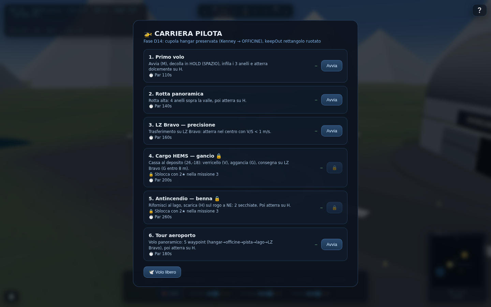

*Missioni 4 e 5 sono bloccate finché non si totalizzano 2 stelle nella missione 3. La missione 6 "Tour aeroporto" è libera.*

### Vista del campo (eliporto H, hangar, pista)

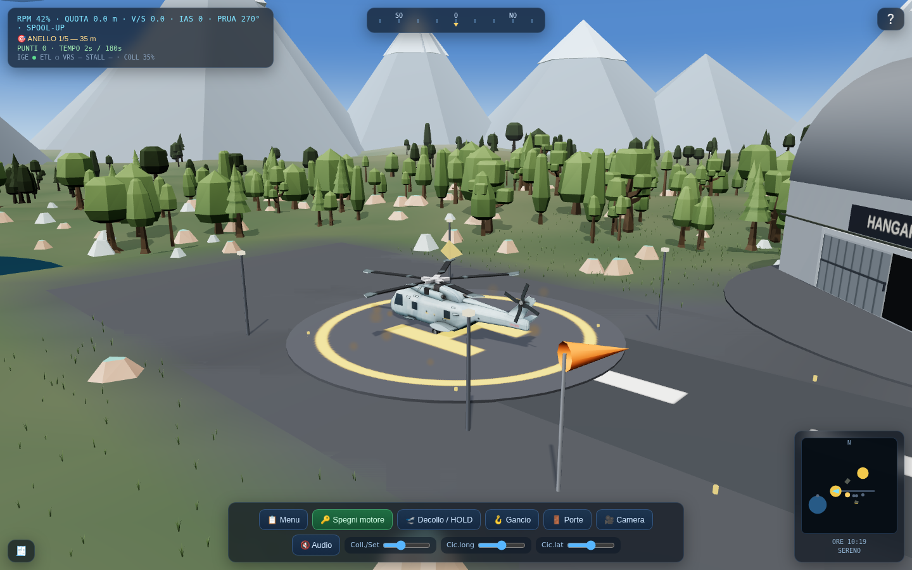

*Elicottero centrato sull'H, prua allineata all'asse, manica a vento, siepi, veicoli e pista "27" con designatore.*

### Hangar con antenne e faro rosso lampeggiante

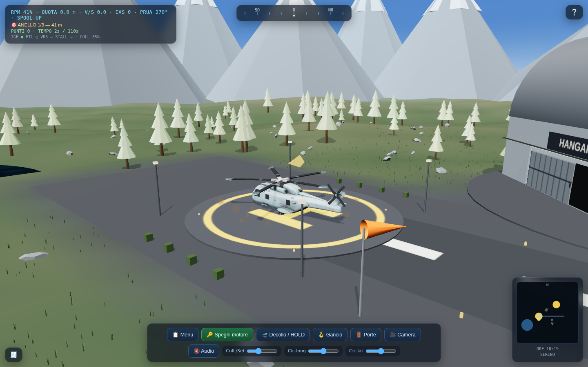

*Dettaglio del tetto del hangar procedurale: due antenne, cella ripetitore e faro rosso che lampeggia a ~1 Hz.*

### Notte + pioggia

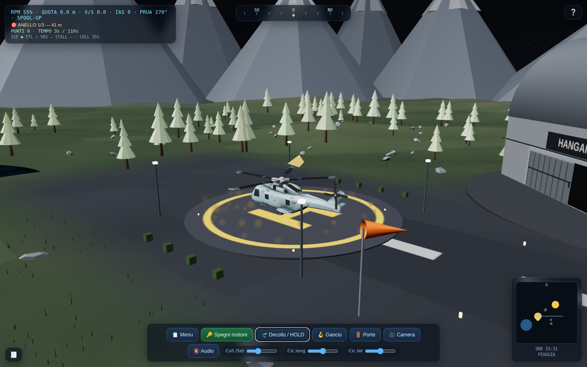

*Cielo stellato, lampioni della pista, fanali del taxi car attivi, terreno "bagnato" con specular, HUD con indicatore allarmi.*

### Pista con lampioni

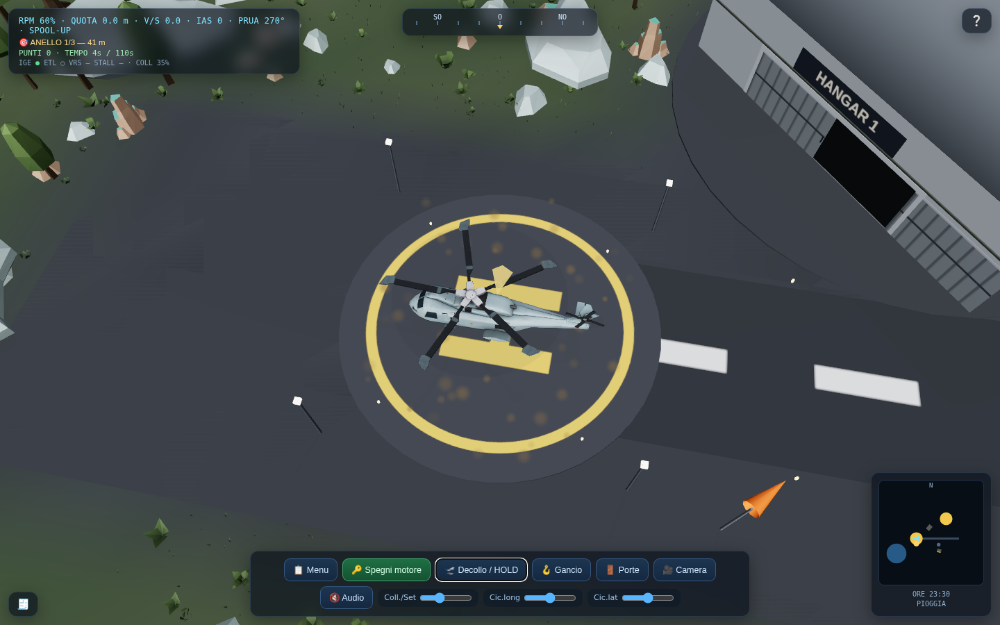

*Il runway con segnaletica "27", soglia di touchdown, e due file di lampioni che si accendono di notte.*

### Tramonto con Rayleigh e capriolo

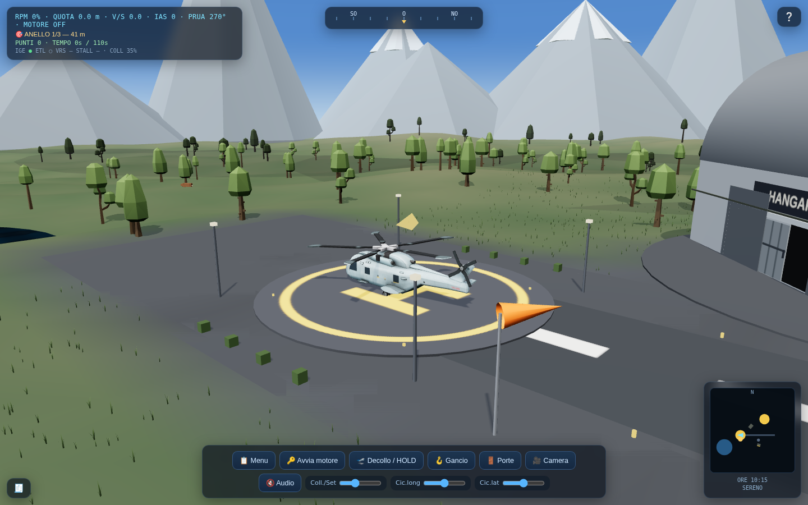

*Colore del cielo con warm glow Rayleigh all'orizzonte; capriolo procedurale visibile tra gli alberi a sinistra dell'eliporto.*

### Veicoli nell'apron

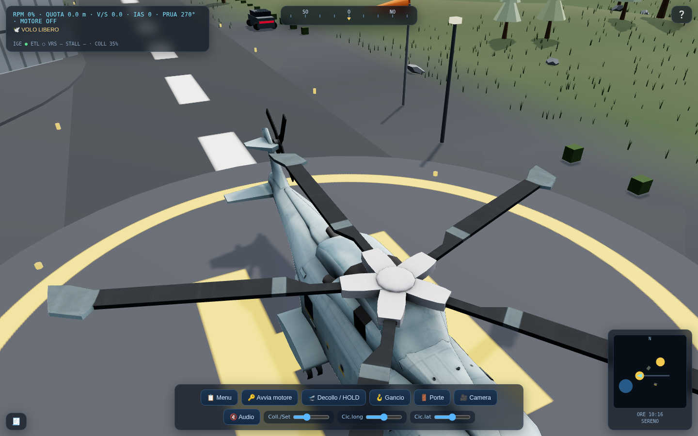

*Il parcheggio aeroportuale: 6 veicoli Kenney (auto rossa, berlina, van bianco, autobus, mezzo antincendio, ambulanza) con vetri riflettenti `MeshPhysicalMaterial`, affianco al taxi car procedurale in movimento sulla taxiway. Lampioni, siepi e asfalto con overlay "bagnato" attivo.*

### Fase D20 — bloom selettivo e paesaggio cinematografico

#### Vista aerea diurna
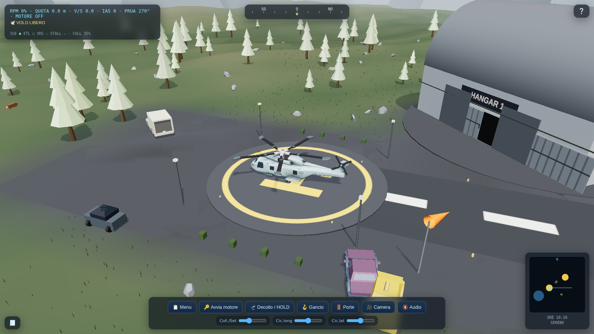

*Fase D20: bloom corretto (niente più aloni sul cemento), manica a vento completa, taxiway, siepi, hangar. Veicoli con colori realistici (taxi giallo, berlina blu, furgone bianco).*

#### Hero shot helipad
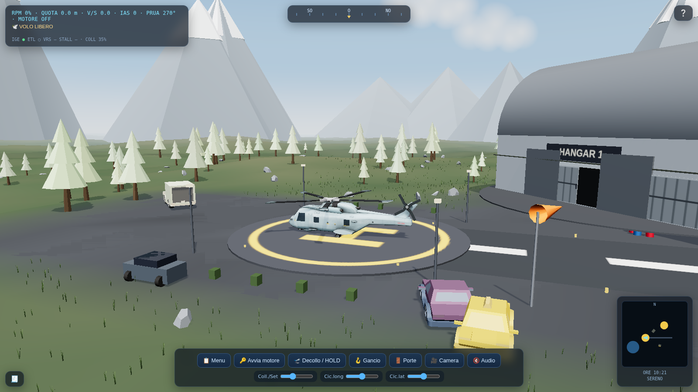

*Composizione "videogame stile film": elicottero centrato, hangar in sfondo, manica a vento in primo piano, veicoli, montagne innevate, nubi sparse, helipad con H gialla ben leggibile.*

#### Tramonto cinematico


*Tramonto (fase DUSK): hangar con cupola contro cielo blu-scuro, foreste in silhouette, elicottero al centro, manica a vento, taxiway, pickup grigio del taxi procedurale. Composizione adatta a inquadratura cinematografica.*

#### Vista notturna con beacon dei soccorsi
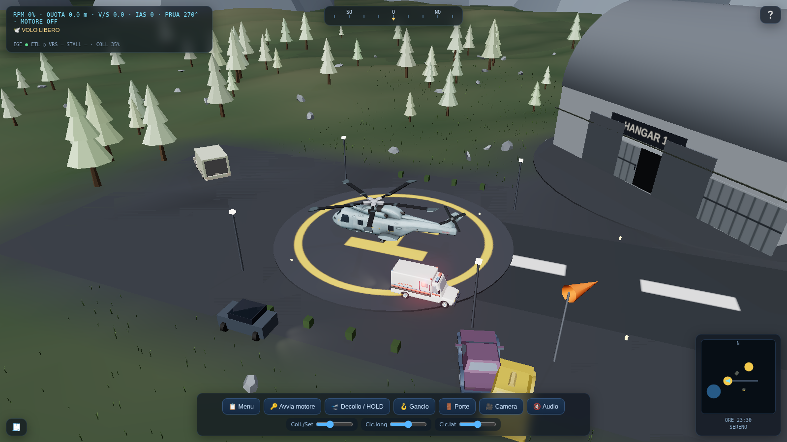

*Notte (kN=1): ambulance bianca con scritte rosse ben visibile, taxi giallo, berlina blu, pickup del taxi procedurale. Le PointLight rosso/blu dei Grab3D illuminano l'asfalto sotto i mezzi. Bloom selettivo attivo solo sui beacon — niente aloni sul cemento o sui lampioni.*

#### Beacon dei mezzi di soccorso
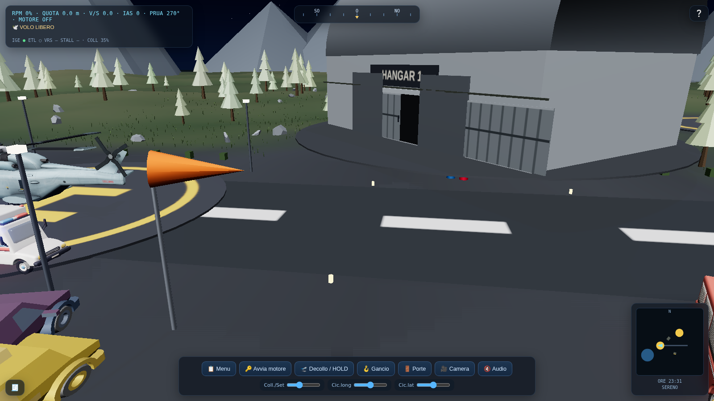

*Close-up notturno dell'area servizi: hangar, manica a vento, luci rosso/blu del beacon Grab3D visibili in basso a destra, pickup grigio, asfalto dettagliato con stripe taxiway, montagne e foresta sullo sfondo.*

### Veicoli nel mondo

Il progetto ha **7 veicoli** totali, con due distinti sistemi di caricamento e nessuna duplicazione:

| Veicolo | Tipo | Posizione | Note |
|---|---|---|---|
| Taxi car | Procedurale | Path loop 10 waypoint | 2 `SpotLight` anteriori, attive solo di notte, ruote sterzate lungo il path; velocità realistica 6 m/s (D20) |
| Berlina (sedan) | Kenney GLB | (10, 12) | Aerporto · colore blu navy |
| Taxi | Kenney GLB | (12, 14) | Aerporto · colore giallo taxi |
| Furgone (delivery) | Kenney GLB | (-24, -6) | Aerporto · colore bianco |
| Tractor (bus fallback) | Kenney GLB | (37, 6) | Aerporto · ruotato 1.2 rad |
| Mezzo antincendio (fire-truck) | Grab3D CC0 | (29, 10) | Ruote + lightbar rosso/blu + fari anteriori (D19) |
| Ambulanza (ambulance) | Grab3D CC0 | (5, 7) | Ruote + lightbar + fari anteriori (D19) |
| Auto polizia (police-car) | Grab3D CC0 | Patrolling perimeter (-35..45, -16..20) | Ruote + lightbar + fari + beacon (D19/D20) |

**Veicoli Kenney (carkit_v1.4):** scaricati live da GitHub API. I materiali con `lum<0.2` (vetri) vengono automaticamente convertiti a `MeshPhysicalMaterial` con `transmission/roughness/envMap` per riflessi realistici. I colori target sono stati ricalibrati (D20) per evitare il lerp "rosa desaturato" sui corpi (sedan blu, taxi giallo, furgone bianco, tractor verde). I veicoli di emergenza (fire/ambulance/police) sono stati **rimossi** dagli spot Kenney per evitare duplicati con i Grab3D: ora appartengono solo al sistema Grab3D.

**Veicoli Grab3D (Cozy Vehicles Kit CC0, D19):** modelli GLB locali in `assets/vehicles/` con animazione ruote, fari anteriori `SpotLight`, beacon overlay `SphereGeometry` emissive (`emissiveIntensity=2.2`) + `PointLight` rosso/blu. La polizia pattuglia un circuito perimetrale dell'apron a velocità realistica.

**Taxi car procedurale (D16):** costruito in `makeTaxiCar()` con `BoxGeometry`/`CylinderGeometry`. Ha:
- Carrozzeria + cabina + vetro (`MeshPhysicalMaterial` riflettente)
- 4 ruote cilindriche
- Fari anteriori `SpotLight` con angolo π·0.22, intensità 4.5 × `__nightK`
- Fanali posteriori rossi emissivi

**Danni atterraggio morbido (D17):** V/S < −3 m/s → sbuffo di polvere `Points` marrone + shake camera + radio warning.

---

## Controlli

### Tastiera

| Tasto | Azione |
|---|---|
| `M` | Avvia / spegni motore |
| `Spazio` | HOLD quota / decollo automatico |
| `R` / `F` | Collettivo su / giù (in HOLD: setpoint quota ± 6 m/s) |
| `W` / `S` | Ciclico longitudinale (avanti / indietro) |
| `A` / `D` | Ciclico laterale (sinistra / destra) |
| `Q` / `E` | Pedali (yaw sinistra / destra) |
| `C` | Cicla camere (5 preset, 4 = cockpit) |
| `P` | Porte / sportello |
| `G` | Aggancia / sgancia carico (verricello) |
| `H` | Sgancia acqua (benna antincendio) |
| `V` / `B` | Verricello estendi / ritira |
| `1` / `2` / `3` | Ora del giorno: giorno / tramonto / notte |
| `O` | Toggle ciclo automatico giorno/notte |
| `J` | Cicla meteo (sereno, vento, pioggia, neve) |
| `U` | Audio on/off |
| `ESC` | Torna al menu |

### Gamepad

| Input | Mappato a |
|---|---|
| Stick sinistro Y | Collettivo (in HOLD: setpoint) |
| Stick destro X/Y | Ciclco longitudinale / laterale |
| Trigger LT/RT (6,7) | Pedali Q / E |
| A (0) | Avvia motore |
| B (1) | HOLD quota |
| X (2) | Porte |
| Y (3) | Camera |
| LB (4) | Audio |
| Start (9) | Menu |

### Mouse (OrbitControls)

- Trascina per orbitare la camera
- Scroll per zoom
- Click su menu/pannelli

---

## Mondo di gioco

Un eliporto alpino con:

- **Eliporto H** centrale (0, 0) — H texture 1024 px, 4 fari, palo manica a vento a 14 m
- **LZ Bravo** secondario a (60, −40) — usato come bersaglio nelle missioni cargo/HEMS
- **Hangar procedurale** (26, −22) — box + cupola cilindrica, antenne e faro rosso lampeggiante
- **Officine Kenney** (46, 24) — edificio car kit, ruotato keepOut, con tacca gialla sulla mappa
- **Pista** orientata a 270° (27), lunghezza 92 m, larghezza 12, designatore + soglia touchdown + 16 lampioni
- **Apron** 70×28, eliporto circolare h=17, con veicoli parcheggiati
- **Lago** (−40, 30), 20 m raggio, acqua riflettente con normalMap animato
- **Fiume** dal lago verso SE, TubeGeometry riflettente
- **Rogo antincendio** (50, 40) — particles shader + PointLight pulsante, usato dalla missione 5
- **Vegetazione Kenney** (alberi, cespugli, fiori) con LOD far forest r 120..200
- **Stormo di uccelli** (procedurale o .glb Flamingo CC0) — animato in cielo con scie di condensa
- **Taxi car** che looppa su 10 waypoint chiuso (6 m/s reali), con fari anteriori che si accendono di notte
- **Nuvole** sprite-based (22 nubi sparse) che scorrono col vento
- **Sole, luna, stelle** posizionati in base all'ora del giorno, con halo e lens flare cinematici
- **Overlay bagnato** che appare con la pioggia
- **Siepi** lungo i bordi della taxiway
- **Recinzione perimetrale** (D20) — 56 paletti, 3 fili e 2 cancelli d'ingresso, raggio 70 m, ancorata al terreno
- **Manica a vento** (D20) — palo + cerchio + sock animata da `windUni.uWind`
- **Bloom selettivo** (D20) — solo i beacon dei mezzi di soccorso, non i lampioni né il cemento
- **Fly-by camera** (D20) — sequenza introduttiva 5.5 s prima del volo libero

### Atmosfera / ciclo giorno

- 4 preset: `sereno`, `vento`, `pioggia`, `neve` (ciclabili con `J`)
- Mix colore cielo in 3 stop: notte → tramonto → giorno
- Fog color che segue il cielo
- Sole e luna con sprite + halo cinematico (D20) visibile soprattutto all'alba/tramonto
- Stellato visibile di notte
- Auto-cycle 600s/giorno

### Post-processing e bloom (D20)

Pipeline `EffectComposer` a 2 stadi per il bloom selettivo:

1. **`bloomComposer`** — renderizza la scena con `camera.layers.set(BLOOM_LAYER)`, dopo aver **oscurato** (mesh → `MeshBasicMaterial` nero) tutti i mesh non appartenenti al layer BLOOM. Applica `UnrealBloomPass` (intensità 1.4, radius 0.8, threshold 0).
2. **`finalComposer`** — renderizza la scena completa e mixa il bloom via `ShaderPass` additivo (`baseTexture + bloomTexture`), poi `OutputPass` per la conversione tonemapping.

Risultato: solo i beacon dei veicoli di soccorso Grab3D (che hanno `layers.enable(1)`) vengono blooomati, evitando aloni sul cemento o sui lampioni.

### Cinematica introduttiva (D20)

`playIntroCine()` attiva una sequenza di 4 keyframes (5.5 s) con interpolazione smoothstep che orbita attorno all'eliporto (partenza `48,18,42` → arrivo al preset 0 `(24,12,26)`). Skip automatico al primo click (`pointerdown`) o richiamando `skipIntroCine()`. Durante l'intro `OrbitControls` è disabilitato.

### Audio ambientale (D20)

`toggleAudio` istanzia i nodi WebAudio solo al primo toggle per rispettare la policy autoplay:

- **Rotore** (sawtooth 38–74 Hz + noise bandpass 90–180 Hz) modulato da `rpm`
- **Stallo** (square 160 Hz) modulato da `fSTALL`
- **Pioggia** (pink noise highpass 900 Hz) gain su `rainMix`
- **Vento** (D20) — pink noise lowpass 400 Hz, gain su `windUni.uWind · (1 − rainMix·0.6)`
- **Whoop sirena** (D20) — sine 620–900 Hz FM, gain su `__nightK` (più forte di notte, simulando la pattuglia police)

---

## Missioni

| # | Nome | Tipo | Par | Note |
|---|---|---|---|---|
| 1 | Primo volo | rings (3) | 110 s | Sempre disponibile |
| 2 | Rotta panoramica | rings (4) | 140 s | Anelli sopra la valle |
| 3 | LZ Bravo — precisione | rings (2) + landing | 160 s | Gate per missioni 4–5 |
| 4 | Cargo HEMS — gancio 🔒 | cargo | 200 s | Richiede 2★ in missione 3 |
| 5 | Antincendio — benna 🔒 | fire | 260 s | Richiede 2★ in missione 3 |
| 6 | Tour aeroporto | tour (5) | 180 s | Waypoint panoramico sempre libero |

Volo libero disponibile dal menu per esplorazione libera.

### Punteggio

- Anello attraversato: 100 pt + 50 pt bonus precisione
- Atterraggio dolce (V/S < 1 m/s): +100 pt
- Atterraggio duro (V/S > 2.5 m/s): −100 pt, "game.hard"
- Tempo entro par: +2 pt/sec residuo
- Cargo: 50 pt aggancio, 200+150 pt consegna
- Antincendio: 50 pt rifornimento, 100 pt sgancio, 200 pt rogo spento

### Stelle

- ⭐ ≥ 40% del target
- ⭐⭐ ≥ 66%
- ⭐⭐⭐ = target pieno (o superato)

Le stelle sono **persistenti** in `localStorage` (chiavi `heli3d_stars_<id>`).

---

## Fisica di volo

Modello didattico a 6 gradi di libertà ridotti:

- **Lift** = `rpm² · (collettivo) · fIGE · fETL · (1 − fVRS) · (1 − fSTALL) − load`
- **V/S** (velocità verticale) integrata con damping `exp(-0.9 dt)`
- **Forze X/Z** da ciclico + yaw, smussate esponenzialmente
- **fIGE** (In Ground Effect) = 1 + 0.22·(1 − alt/9)² entro 9 m
- **fETL** (Translational Lift) = 1 + 0.16·smooth(IAS, 3, 10)
- **fVRS** (Vortex Ring State) = 0.6·smooth(−V/S, 1.5, 5)·(1−smooth(IAS,3,8))
- **fSTALL** = 0.25·smooth(IAS, 16, 26)

In **HOLD** mode (`Spazio`), un PID mantiene `alt ≈ setpoint` regolando il trim integrale.

Allarmi radio attivi:
- IGE lasciato: "serve più collettivo"
- ETL acquisito: "puoi ridurre il collettivo"
- VRS: "VORTEX RING STATE! Guadagna velocità (W)"
- Stallo: "Stallo pala retrocedente: rallenta"

---

## Struttura del codice

`index.html` (~2200 righe) è organizzato come:

| Sezione | Righe circa | Contenuto |
|---|---|---|
| `<head>` + CSS | 1–290 | Stili pannelli, hud, menu, minimappa, bussole, gauge |
| `<body>` HTML | 291–320 | Pannelli UI (topstrip, compass, dock, log, radio, menu, results) |
| Costanti (LAKE, FIRE, HANGAR, OFFICE) | 322–335 | Posizioni mondo |
| **Terreno + laghi + fiume + wet overlay** | 335–380 | Mesh `PlaneGeometry` con vertex colors + fiume + normalMap lago |
| Hangar procedurale (con antenne/faro) | 487–510 | Box + cupola + antenne + faro rosso |
| Manica a vento | 510–520 | Palo + sock con flutter aggiuntivo |
| Montagne / picchi innevati | 512–530 | 26 coni con cappelli di neve |
| Cespugli + erba + uccelli + fuoco + splash | 517–610 | Geometrie procedurali, particles shader, Nuvole |
| `patchWind` (shader vento + downwash uniforms) | 206–240 | Modifica onBeforeCompile per InstancedMesh alberi |
| Cielo, sole, luna, stelle, nubi | 800–950 | Sprite, shader cielo a 3 colori |
| `applyTod` (ciclo giorno/notte) | 1493–1510 | Aggiorna colore cielo, nebbia, hemi, sole, GLOW; set `__nightK` |
| Heliporti (con texture H) | 335–345 | CylinderGeometry con canvas texture |
| **Pista + segnaletica + lampioni** | 349–365 | PlaneGeometry con canvas "27" + threshold + 16 lampioni |
| **Apron + veicoli + siepi** | 357–370 | Plane + Kenney vehicles + hedges esterne |
| Missioni + best score + stars | 1282–1335 | Array `MISSIONS`, `renderMenu`, gating |
| `startMission` / `endMission` / `finish*` | 1351–1395 | Game loop missioni |
| Verricello + benna + hook | 1396–1422 | Fisica del carico e dell'acqua |
| Mini-mappa, bussola, gauge | 1424–1490 | Canvas 2D |
| Input handlers (keydown, gamepad) | 1545–1642 | Mappatura tasti + gamepad poll |
| **Miglioramenti D16** (heli shadow, taxi, LOD, tour) | 1555–1600 | |
| **Miglioramenti D17** (lago, fari, downwash, beacon, danni, HUD VRS) | vari | |
| **Miglioramenti D19** (Grab3D vehicles, lightbar, missione 7) | 1334–1420 | |
| **Miglioramenti D20** (bloom, intro, fence, windsock, audio) | 168–230 / 1469–1530 / 2160–2200 | |
| `animate()` loop | 2128–2200 | Game loop: fisica, camera, render (2-composer bloom) |

---

## Roadmap delle fasi

| Fase | Contenuto |
|---|---|
| **A** | Scheletro 3D: terreno, hangar, eliporto, elicottero procedurale, camera chase |
| **B** | Modello .glb reale, mixer animazioni, rotori con blur, fisica base |
| **C** | Missioni rings, cargo, fire; verricello; benna; minimappa; bussola; ciclici collettivi; HUD |
| **D1–D10** | Iterazioni bug-fix e miglioramenti visivi (illuminazione, nebbia, allarmi radio) |
| **D11** | Kenney: nature (alberi, cespugli), vehicles (car kit), offices |
| **D12** | Nature LOD + bird flock + sky shader + auto-cycle |
| **D13** | Controlli PresetSlider, OrbitControls, Damping 3D |
| **D14** | Hangar con cupola, OFFICE ruotato, runway centerline, keepOut hangar rettangolare |
| **D15** | Minacce / waypoint indicator, OFFICE map tacca gialla |
| **D16** | Progressione missioni 2★, gamepad, missione 6 "Tour", traffico taxi, heli shadow, LOD far forest |
| **D17** | Lago riflettente, fanali notturni veicoli, erba reattiva downwash, beacon/faro hangar, vetri riflettenti, siepi, fiume, scie uccelli, danni atterraggio morbido, vibrazione HUD VRS, runway "27" + touchdown |
| **D18** | Audio "blat" stallo, porte hangar interattive (si aprono entro 20 m), ombra nuvole sul terreno, atmosfera Rayleigh (warm glow al tramonto), cenere rogo, caprioli procedurali con path AI |
| **D19** | 3 veicoli soccorso Grab3D CC0 (fire-truck, ambulance, police-car) con ruote animate, beacon overlay, fari notturni, pattuglia, missione 7 "Servizio aeroportuale" |
| **D20** | Post-processing UnrealBloomPass selettivo a 2-composer, fly-by camera introduttiva, halo cinematico del sole, recinzione perimetrale aeroporto (56 paletti + 3 fili + 2 cancelli), manica a vento animata, audio vento + whoop sirena, fix duplicati veicoli e colori non ufficiali, fix taxi "sfreccia", fix encoding GitHub API (`encodeURIComponent`) |

---

## Cosa resta da fare

Proposte non ancora implementate (in ordine di complessità crescente):

### XS
- ❌ Pneumatici dei veicoli sterzati in curva
- ❌ Specchietti retrovisori + tergicristalli sui veicoli Kenney
- ❌ Ombra "soft contact" sotto ogni veicolo statico
- ❌ LOD esteso a rocce/cespugli/fiori (solo alberi hanno LOD)

### S
- ❌ Più taxi cars (2–3) con frecce lampeggianti prima delle curve
- ❌ Camion cisterna al lago per missione antincendio
- ❌ Decal "impronta" su neve dopo atterraggio

### M
- ❌ Scioglimento neve bagnata su pista (decals canvas)
- ❌ Polvere/cenere in volo vicino al rogo (cenere già presente, polvere no)

### L
- ❌ Neve cumulativa su cime e tetti con displacement
- ❌ Sistema di danni completo (contatto duro → danni rotore, fumo persistente, fine missione)
- ❌ Missione "Taxi a terra" con guida waypoint di un veicolo di terra

### Bug-fix completati (D20)
- ✅ Taxi che "sfreccia avanti e indietro" → riscritto a 6 m/s con path chiuso 10-waypoint
- ✅ Veicoli di emergenza duplicati (Kenney + Grab3D sovrapposti) → rimossi Kenney fire/ambulance/police
- ✅ Colori "tendenti al rosa" non ufficiali → tavolozza aeroporto + `lerp 0.85`
- ✅ GitHub API 403 su path con spazi (`GLTF format`) → `encodeURIComponent` in `listKenney`
- ✅ Police nel bosco a (-40,-25) → circuito perimetrale apron realistico
- ✅ Rocce Kenney "tetto menta/rosa" → ricolorate verso grigio naturale con clamp

---

## Test

I test visivi di regressione usano **Playwright + Chromium** con `--use-gl=angle` per WebGL in headless (vedi `/tmp/kilo/shot/`). Catturano ~13 shot per run:

- Menu missioni renderizzato correttamente
- Sequenza fly-by camera (5 frame consecutivi)
- Aerial diurnal/notturno/tramonto (`aerial_day`, `aerial_night`, `sunset_hero`)
- Veicoli di soccorso + bloom sui beacon (`service_close`, `service_night`)
- Police in pattuglia (`police_patrol`)
- Hero shot elipad (`helipad_hero`)
- Approccio cinematico (`cinematic_approach`)

Validano inoltre:
- Modulo JS carica senza errori (`pageerror` listener)
- Compositor 2-pass (bloom + final) produce frame non saturi
- HUD telemetria aggiornata
- Recinzione perimetrale visibile senza artefatti sui cancelli
- 0 NaN, 0 errori non-risorsa (eccetto atteso 404 su `assets/helicopter.glb`)

### Come riprodurre i test

```bash
# 1. Server statico del progetto
python3 -m http.server 8123

# 2. Sparse-clone del repo Kenney per il car kit (evita rate-limit API)
git clone --depth 1 --filter=blob:none --sparse https://github.com/ETdoFresh/kenney.nl.git /tmp/kn
cd /tmp/kn && git sparse-checkout set carkit_v1.4/Models/GLTF\ format

# 3. Crea una copia strumentata del progetto che serve il car kit da localhost
mkdir -p /tmp/local && cp -r /workspace/app/assets /tmp/local/
mkdir -p /tmp/local/carkit_v1.4/Models
cp -r "/tmp/kn/carkit_v1.4/Models/GLTF format" "/tmp/local/carkit_v1.4/Models/"
# patch per esporre camera/controls su window (per test)
sed 's|const controls=new OrbitControls(camera,renderer.domElement);|const controls=new OrbitControls(camera,renderer.domElement);window.__cam=camera;window.__ctl=controls;window.__scene=scene;|' /workspace/app/index.html > /tmp/local/index.html

# 4. Server per la copia strumentata
python3 -m http.server 8124 &  # root /tmp/local

# 4. Pre-seeda il localStorage per saltare l'enumerazione GitHub API
python3 -c "
import json, os, urllib.parse
root='/tmp/kn/carkit_v1.4/Models/GLTF format'
files=[{'name':f,'download_url':'http://localhost:8123/carkit_v1.4/Models/GLTF%20format/'+f} for f in os.listdir(root) if f.endswith('.glb')]
json.dump({'carkit_v1.4':{'t':0,'files':files}}, open('kitcache.json','w'))
"

# 5. Esegui Playwright (lo script seeda localStorage, attende Grab3D, scatta)
node /path/to/shot3.js http://localhost:8123/index.html vN
```

Gli screenshot migliori vengono archiviati in `docs/images/08_d20_*.png ... 12_d20_*.png` come riferimento visivo della Fase D20.

---

## Licenza

Modelli `Kenney.nl` / `kenney.cc`: **CC0** (dominio pubblico).
Modello elicottero `srcejon/sdrangel-3d-models`: controllare licenza del repo.
Veicoli soccorso `Cozy Vehicles Kit` (Grab3D CC0): **CC0**.
Flamingo `three.js` examples: CC0.
Three.js: MIT.

---

## Changelog

| Versione | Data | Note |
|---|---|---|
| Fase D20 | 2026-10 | Post-processing UnrealBloomPass selettivo a 2-composer, fly-by camera introduttiva, halo cinematico del sole, recinzione perimetrale aeroporto, windsock animata, audio vento + whoop sirena, fix duplicati veicoli emergenza, fix colori non ufficiali, fix taxi teleport, fix encoding GitHub API |
| Fase D19 | 2026-09 | 3 veicoli soccorso Grab3D CC0 (fire-truck, ambulance, police-car) con ruote animate, beacon overlay, fari notturni, pattuglia, missione 7 "Servizio aeroportuale" |
| Fase D18 | 2026-08 | Audio "blat" stallo, porte hangar interattive, ombra nuvole, atmosfera Rayleigh, cenere rogo, caprioli procedurali |
| Fase D17 | 2026-07 | Lago riflettente, fanali notturni veicoli, erba reattiva downwash, beacon/faro hangar, vetri riflettenti, siepi, fiume, scie uccelli, danni atterraggio, vibrazione HUD VRS, runway "27" + touchdown |

---

*Sviluppato in single-file architecture per facilitare distribuzione e ispezione. Nessun bundler, nessuna dipendenza installata localmente.*
